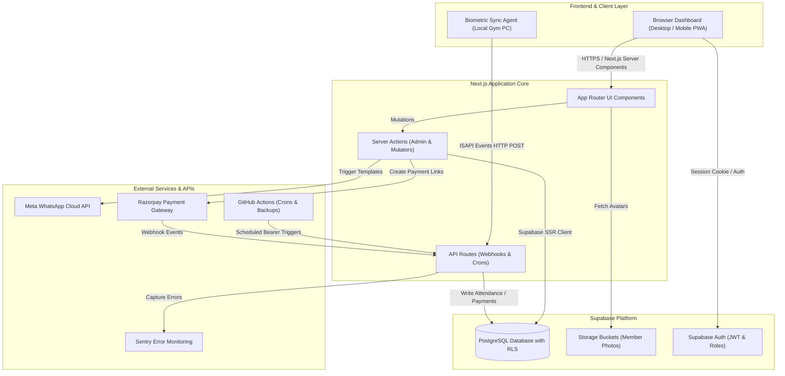

# About Altrex GMS (Gym Management System)

  
  
<strong>The Complete Operating System for High-Performance Fitness Facilities</strong>

---

## 🎯 Vision & Background

**Altrex GMS** is a full-stack, enterprise-grade gym management solution engineered specifically to eliminate administrative friction and streamline operations for modern fitness centers. 

Managing a modern gym requires coordinating several disparate workflows:
- Tracking active memberships and renewals without manual spreadsheets.
- Enforcing access control via biometric face terminals without delays at the entrance.
- Processing payments, chasing overdue balances, and generating official tax/payment receipts.
- Engaging members proactively through WhatsApp for renewals, birthdays, and inactivity alerts.
- Delivering high-level business intelligence to owners while providing front-desk staff with a fast, intuitive daily operational dashboard.

Altrex GMS unifies all of these functions into a single, cohesive, cloud-native web platform.

---

## 🏛️ System Architecture

The application is built on modern web standards utilizing Next.js (App Router), Supabase (PostgreSQL with Row Level Security), Tailwind CSS, and external integrations for automated billing and messaging.

---

## 🧩 Core Functional Modules

### 1. Member Lifecycle Management
- **Comprehensive Profiles**: Stores personal details, contact info, emergency contacts, blood group, medical conditions, and physical metrics (height, weight, automated BMI calculation).
- **Status Lifecycle Engine**: Dynamically classifies members into `active`, `expiring` (within 7 days of expiration), `expired`, `inactive` (unattended for 7+ days), or `archived`.
- **Photo Storage**: High-resolution avatar uploads powered by Supabase Storage with automatic caching and secure public read permissions.
- **Split Timings**: Segment morning and evening shift attendees to monitor floor congestion.

### 2. Smart Biometric Attendance
- **Hikvision Face Recognition**: Bridges local Hikvision biometric access terminals to the cloud via the lightweight companion `sync-agent`.
- **Manual Fallback**: Front desk staff can check members in manually with instant cooldown logic preventing duplicate check-ins on the same day.
- **Live Attendance Feed**: Real-time live attendance feed updating as members walk into the facility.

### 3. Payments, Invoicing & Billing
- **Payment Recording**: Supports cash, UPI (with UTR reference capture), credit/debit cards, and online payments.
- **Razorpay Integration**: Instantly generates Razorpay dynamic payment links and QR codes sent to members via WhatsApp for quick renewals.
- **Automated Webhooks**: Verifies incoming Razorpay HMAC signatures to automatically mark memberships as active upon customer payment.
- **Client-Side PDF Generator**: Generates professional branded payment receipts with one-click download using `jspdf` and `jspdf-autotable`.
- **Overdue Dues Tracker**: Dedicated panel highlighting members with pending balances, offering single-click WhatsApp payment reminders.

### 4. Personal Training (PT) Management
- **PT Packages**: Configurable training packages defining session counts, pricing, and validity duration.
- **Assignment & Tracking**: Assign personal trainers to members, monitor sessions completed vs remaining, and deduct sessions per training workout.
- **Trainer Accountability**: Real-time visibility into active PT clients and expiring packages.

### 5. WhatsApp Automation Engine
Directly integrated with the official **Meta WhatsApp Cloud API** to deliver automated, professional notifications:
- **Welcome Message**: Triggered automatically when a new member is enrolled.
- **Payment Receipt**: Instant payment confirmation detailing amount paid, plan duration, and renewal date.
- **Renewal Reminders**: Sent 7 days, 3 days, and 1 day prior to plan expiration with payment link.
- **Inactivity Alerts**: Sent to members absent for 7+ consecutive days to encourage re-engagement.
- **Birthday Wishes**: Automatically greets members on their birthdays.
- **Daily Owner Summary**: Sent every night to the gym owner detailing daily revenue, new enrollments, and footfall count.

### 6. Scheduled Automation (GitHub Actions Crons)
Instead of relying on fragile in-process cron jobs, Altrex GMS leverages **GitHub Actions** scheduled workflows:
- `10 0 * * *` (5:40 AM IST): Recomputes member membership statuses for the day.
- `30 3 * * *` (9:00 AM IST): Sends upcoming renewal notifications via WhatsApp.
- `0 4 * * *` (9:30 AM IST): Scans for inactivity and dispatches re-engagement messages.
- `0 16 * * *` (9:30 PM IST): Aggregates end-of-day analytics and delivers the executive summary to the owner.

### 7. Security & Role-Based Access Control (RBAC)
- **Front Desk Staff**: Operational access to member profiles, check-in feeds, recording payments, and plan renewals. Sensitive financial analytics are restricted.
- **Gym Owner**: Full executive privileges, including real-time revenue graphs, monthly growth trends, package configurations, and staff management.
- **Row Level Security (RLS)**: Enforced directly at the PostgreSQL layer in Supabase, preventing unauthorized queries from client sessions.
- **Encrypted Webhook Verification**: Constant-time HMAC SHA-256 validation prevents spoofing of payment or WhatsApp callbacks.

### 8. Automated Disaster Recovery & Backups
- A dedicated scheduled GitHub Actions workflow runs every night at 2:00 AM UTC.
- Executes `pg_dump` against the production PostgreSQL instance with clean drop statements.
- Compresses the backup into a timestamped `.tar.gz` archive.
- Uploads the archive to GitHub Artifacts with a 90-day retention guarantee.

---

## 💻 Tech Stack Summary

| Layer | Technologies |
|---|---|
| **Framework** | Next.js 15 (App Router, Server Actions) |
| **Language** | TypeScript (Strict mode enabled) |
| **Styling** | Tailwind CSS v4, Lucide Icons |
| **UI Components** | Radix UI primitives, Sonner toasts |
| **Database & Auth** | Supabase (PostgreSQL 17, RLS, Storage) |
| **State & Cache** | TanStack React Query v5, Zustand |
| **Payments** | Razorpay Node.js SDK & Webhooks |
| **Messaging** | Meta WhatsApp Business Cloud API |
| **Validation** | Zod Schema Validation |
| **PDF Generation** | jsPDF, AutoTable |
| **Monitoring** | Sentry Next.js SDK |
| **CI/CD & Crons** | GitHub Actions |

---

## 🛡️ License & Ownership

This software is proprietary and custom-built for **Altrex Fitness**. All rights reserved.
