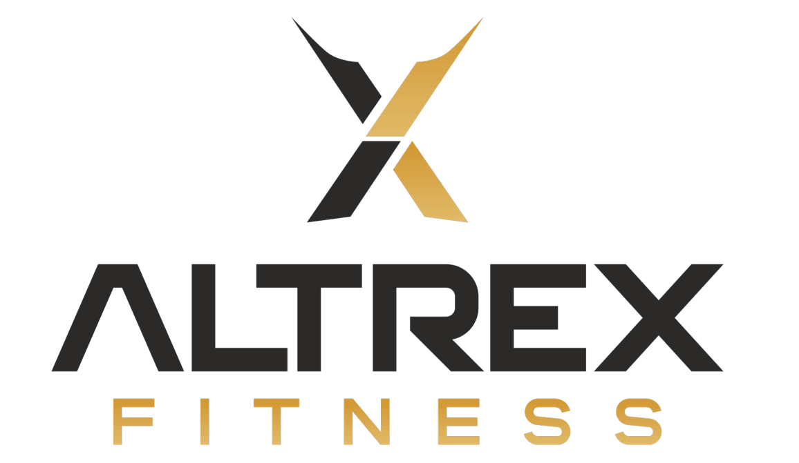

<div align="center">
  
  <h1>Altrex GMS</h1>
  <p><strong>Next-Generation Operating System for Modern Gyms & Fitness Facilities</strong></p>

  [](https://nextjs.org/)
  [](https://www.typescriptlang.org/)
  [](https://tailwindcss.com/)
  [](https://supabase.com/)
  [](https://github.com/your-username/altrex-gms/actions/workflows/ci.yml)

  <br />

  [Explore Architecture (ABOUT.md)](./ABOUT.md) • [Database Guide (supabase/)](./supabase/README.md) • [Biometric Sync Agent](./sync-agent/README.md) • [Contribution Standards](./CONTRIBUTING.md)
</div>

---

## 🚀 Overview

**Altrex GMS (Gym Management System)** is a comprehensive, production-ready full-stack application built to automate front-desk operations, member lifecycle management, biometric access control, online billing, and customer communication for **Altrex Fitness**.

By integrating **Supabase PostgreSQL**, **Hikvision Biometric Face Terminals**, **Razorpay Payments**, and the **Meta WhatsApp Cloud API**, Altrex GMS eliminates spreadsheets and manual administrative tasks.

For an in-depth breakdown of features, domain modules, and architectural decisions, see [**ABOUT.md**](./ABOUT.md).

---

## ✨ Key Capabilities

* 👥 **Member Management**: Detailed profiles, health & biometric records (height, weight, automated BMI), and plan duration tracking.
* 📸 **Smart Attendance**: Real-time check-in stream powered by Hikvision face-recognition terminals and staff manual check-in with cooldown guards.
* 💳 **Automated Billing & Invoicing**: Razorpay payment link generation, instant WhatsApp receipts, overdue balance reminders, and PDF invoice downloads.
* 🏋️ **Personal Training (PT)**: Manage trainers, configure session-based PT packages, and track active client session deductions.
* 📱 **WhatsApp Automation**: Automated welcome messages, renewal reminders (7-day, 3-day, 1-day), birthday greetings, inactivity alerts, and nightly owner executive summaries.
* 🛡️ **Role-Based Access (RBAC)**: Distinct permissions for **Gym Owners** (revenue charts, financial metrics, package configurations) and **Front Desk Staff** (daily check-ins and member registration).
* 🔄 **Automated Cloud Backups**: Nightly `pg_dump` database exports to GitHub Artifacts with 90-day retention.

---

## 📂 Project Structure

```
altrex-gms/
├── .github/
│   └── workflows/              # CI pipeline, automated daily crons & database backup workflows
├── public/                     # Static assets, branding logos, manifest, and icons
├── src/
│   ├── app/                    # Next.js App Router
│   │   ├── (auth)/             # Login & authentication routes
│   │   ├── (dashboard)/        # Protected operational pages (Members, Attendance, Payments, PT, Plans)
│   │   └── api/                # API routes for webhooks (Razorpay, WhatsApp), devices & crons
│   ├── components/             # Modular React UI components
│   │   ├── attendance/         # Real-time attendance feed & manual check-in
│   │   ├── dashboard/          # Analytics stat cards & revenue charts
│   │   ├── members/            # Member profile, table, renewal, and edit modals
│   │   ├── payments/           # Invoicing tables, overdue dues, and Razorpay links
│   │   ├── plans/              # Membership plan cards and creation forms
│   │   ├── pt/                 # Personal training assignment and session deductions
│   │   └── ui/                 # Reusable accessible UI primitives (buttons, dialogs, sheets)
│   ├── hooks/                  # React Query hooks for client-side data fetching
│   ├── lib/                    # Core utilities & API integrations
│   │   ├── essl/               # Biometric raw data parser
│   │   ├── razorpay/           # Razorpay SDK initialization
│   │   ├── supabase/           # SSR and client Supabase client factories
│   │   ├── utils/              # Currency formatting, Tailwind cn helper, PDF invoice generator
│   │   ├── validations/        # Zod validation schemas
│   │   └── whatsapp/           # Meta WhatsApp Cloud API client
│   └── types/                  # TypeScript interface and database definitions
├── supabase/
│   ├── schema.sql              # Complete consolidated database schema, RLS, and indexes
│   ├── scripts/                # Utility SQL scripts (set_owner.sql, reset_test_data.sql)
│   └── README.md               # Supabase setup and administration instructions
├── sync-agent/                 # Companion daemon for local Hikvision Biometric machine sync
├── .env.example                # Documented environment variable template
├── ABOUT.md                    # Detailed architectural and domain documentation
├── CONTRIBUTING.md             # Contribution guidelines, conventional commits & linting
└── README.md                   # This file
```

---

## 🛠️ Tech Stack

* **Frontend**: Next.js 15 (App Router, Server Actions), React 19, Tailwind CSS v4, Lucide Icons
* **Backend**: Next.js Server Actions & API Routes
* **Database & Auth**: Supabase (PostgreSQL 17, Row Level Security, Storage Buckets)
* **Data Fetching**: TanStack React Query v5
* **Payment Processing**: Razorpay API & Webhook HMAC Verification
* **Customer Messaging**: Meta WhatsApp Business Cloud API
* **Error Tracking**: Sentry
* **Automation**: GitHub Actions (Scheduled Daily Crons & Automated Backups)

---

## 🚀 Getting Started

### Prerequisites

* **Node.js**: v18.x or v20.x or higher
* **npm**: v9.x or higher
* A free or paid **Supabase** account
* A **Razorpay** account (for payments)
* A **Meta Developer** account with WhatsApp Cloud API configured

### Step 1: Clone the Repository

```bash
git clone https://github.com/your-username/altrex-gms.git
cd altrex-gms
```

### Step 2: Install Dependencies

```bash
npm install
```

### Step 3: Configure Environment Variables

Create your local environment file by copying the template:

```bash
cp .env.example .env.local
```

Open `.env.local` and fill in your keys:
* Supabase project URL, Anon Key, and Service Role Key.
* Razorpay Key ID and Secret.
* Meta WhatsApp Cloud API credentials.
* Cron Bearer Secret.

See [`.env.example`](./.env.example) for detailed comments on each variable.

### Step 4: Initialize the Database

1. Open your [Supabase SQL Editor](https://supabase.com/dashboard).
2. Run the script in [`supabase/schema.sql`](./supabase/schema.sql).
3. To assign owner permissions to your account, run [`supabase/scripts/set_owner.sql`](./supabase/scripts/set_owner.sql).

### Step 5: Start the Development Server

```bash
npm run dev
```

Open [http://localhost:3000](http://localhost:3000) in your browser.

---

## 📜 Available Scripts

| Command | Description |
|---|---|
| `npm run dev` | Launches the Next.js local development server with Turbopack |
| `npm run build` | Compiles the production build |
| `npm run start` | Starts the production server |
| `npm run lint` | Runs ESLint across all source files |
| `npx tsc --noEmit` | Runs full TypeScript static type checking |

---

## 🔄 Daily Automation & Crons

Automations are triggered via GitHub Actions workflows in `.github/workflows/crons.yml`:

| Time (IST) | Trigger Endpoint | Purpose |
|---|---|---|
| **5:40 AM** | `/api/cron/update-statuses` | Re-evaluates active vs expired memberships |
| **9:00 AM** | `/api/cron/renewal-reminders` | Sends WhatsApp renewal reminders |
| **9:30 AM** | `/api/cron/inactivity-check` | Re-engages members absent for 7+ days |
| **9:30 PM** | `/api/cron/owner-summary` | Delivers end-of-day revenue & footfall summary to owner |

---

## 🤝 Contributing

We welcome contributions! Please review [**CONTRIBUTING.md**](./CONTRIBUTING.md) for branch naming standards, TypeScript requirements, and conventional commit rules enforced by Husky and Commitlint.

---

## 📄 License

Proprietary software built exclusively for **Altrex Fitness**. All rights reserved.
